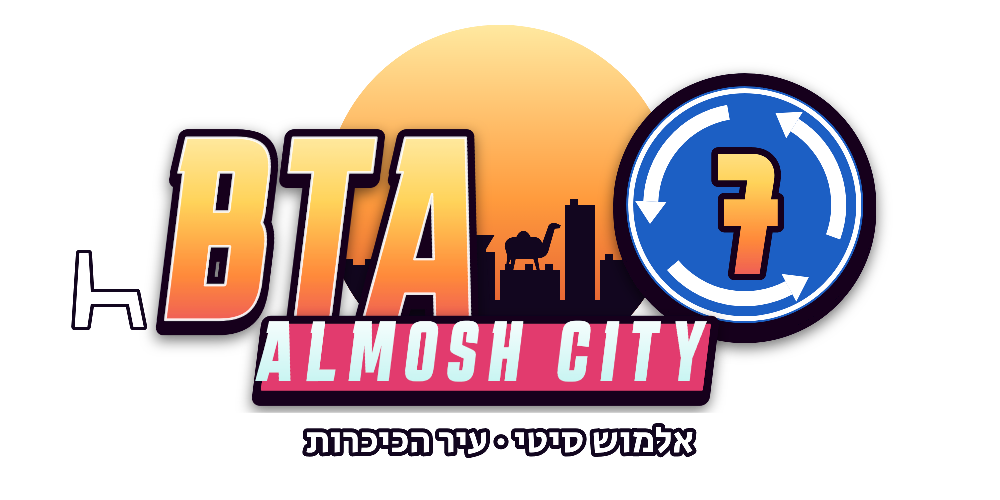
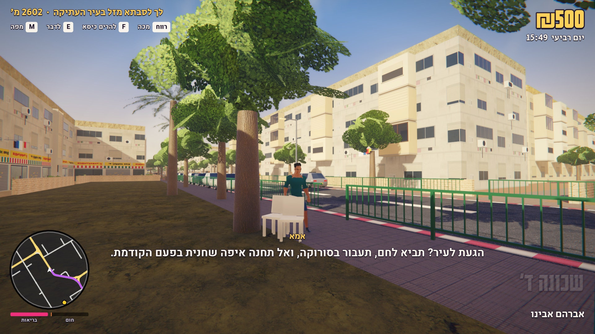

# BTA 7 אלמוש סיטי

**משחק עולם פתוח סאטירי בקוד פתוח, ברחובות האמיתיים של באר שבע.**
בנוי על [Godot 4.3](https://godotengine.org). חינם לשחק, חינם לשנות, חינם לפצל.

[English](README.md) · [איך תורמים](CONTRIBUTING.md#בעברית-בקצרה) · [קרדיטים](CREDITS.md) · [רישיונות](#רישיונות)

> **זו סאטירה.** המשחק התחיל כבדיחה פרטית של חברים שגדלו ליד באר שבע, והוא צוחק על כולם באותה מידה:
> הבדואים, העולים מברית המועצות, המזרחים הוותיקים, הסטודנטים, הסבתות, הפקחים והעירייה.
> כל הכנופיות והדמויות בדיוניות, ואין כאן דיוקן של אף אדם או קהילה אמיתיים. לא ההומור שלכם?
> כנראה שגם לא המשחק שלכם. עוד ב-[docs/SATIRE.md](docs/SATIRE.md).

## מה יש בו

- רשת הרחובות ומתארי הבניינים האמיתיים של באר שבע, מהעיר העתיקה עד רמות, מתוך OpenStreetMap,
  עם בית הפירמידה, מרכז הנגב, התחנה הטורקית ועוד.
- אנשים באים אליך: סוחר עם עסקה, סבתא עם צלחת, פקח עם דוח. **E** זה כן, **Q** זה לא, וחיים עם התוצאה.
  118 מפגשים כאלה, כולם בקובצי JSON פשוטים.
- נהיגה עם תנועה, בלם יד, נזק ושריפות. קטטות רחוב עם כסאות כתר פלסטיק. רקטות, גמלים וסופות חול.
  יום ולילה. רדיו עם חמש תחנות ותחנה של תקליטי 78.

## איך משחקים

1. מתקינים [Godot 4.3](https://godotengine.org/download/archive/4.3-stable/) (הגרסה הרגילה, לא ‎.NET).
2. משכפלים את הריפו: `git clone https://github.com/dorongree-spec/bta7-almosh-city.git`
3. ב-Godot בוחרים **Import**, מצביעים על `project.godot` ולוחצים **F5**. הייבוא הראשון לוקח דקה-שתיים.

**מוזיקה משלכם:** שמים קובצי `.mp3` או `.ogg` בתיקייה בשם `music` ליד המשחק (או בתיקיית הפרויקט כשמריצים
מ-Godot), והתחנה "הדיסק של אבא" מנגנת אותם.

| מקש | פעולה |
|---|---|
| WASD / חצים | הליכה ונהיגה |
| Shift | ריצה |
| רווח / קליק | מכה, ובלם יד ברכב |
| F | כניסה ויציאה מרכב, הרמת כיסא |
| E / Q | כן / לא. ‏**E** ליד עובר אורח פותח שיחה |
| R | רדיו · **H** צופר · **M** מפה |
| Esc | הפסקה |

## לשפר את המשחק

רוב המשחק הוא תוכן ולא קוד, ואפשר להוסיף לו בלי לדעת לתכנת:

| רוצים להוסיף... | איפה | צריך קוד? |
|---|---|---|
| דמות שניגשת עם הצעה, בדיחה או דוח | `data/encounters_*.json` | לא |
| תחנת רדיו או שיר | `data/world.json` ו-`assets/audio/radio/` | לא |
| בדיחה, שלט, שיחה מאמא, פרסומת ברדיו | `data/world.json` | לא |
| שם למקום במפה | `tools/guess_heights.py` (הרשימה `KNOWN`) | שורה אחת |
| בניין ציון דרך | `scripts/landmarks.gd` | כן, GDScript |

ההוראות המלאות וכללי התוכן ב-**[CONTRIBUTING.md](CONTRIBUTING.md)**. לפני ששולחים:
`python3 tools/validate_content.py` בודק את כל קבצי התוכן.

## רישיונות

| מה | רישיון |
|---|---|
| קוד | [MIT](LICENSE) |
| התוכן שלנו: טקסטים ובדיחות, אמנות, תיעוד | [CC BY-SA 4.0](LICENSES/CC-BY-SA-4.0.txt) |
| נתוני המפה (נגזרים מ-OpenStreetMap) | [ODbL 1.0](LICENSES/ODbL-1.0.txt), © תורמי OpenStreetMap |
| מודלים, מרקמים, צלילים ומוזיקה של צד שלישי | CC0 ונחלת הכלל, פירוט ב-[assets/CREDITS.md](assets/CREDITS.md) |
| גופנים | [SIL OFL 1.1](LICENSES/OFL-1.1.txt) |

"BTA 7 אלמוש סיטי" הוא שם פרודי. לפרויקט אין קשר לשום משחק, מפרסם או מותג מסחרי.

