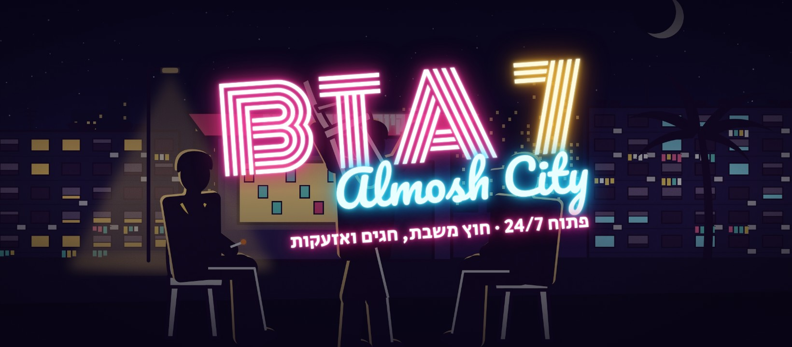
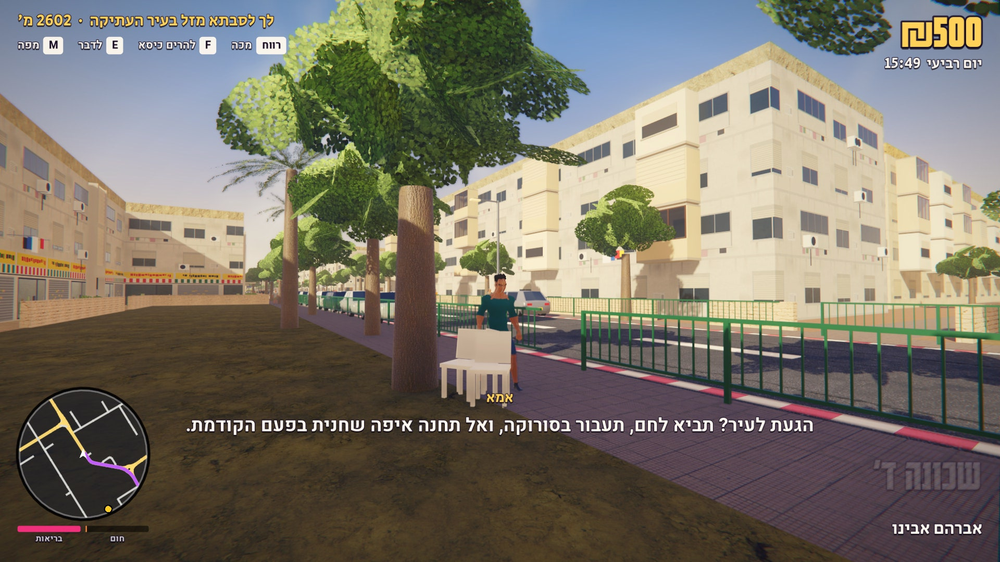
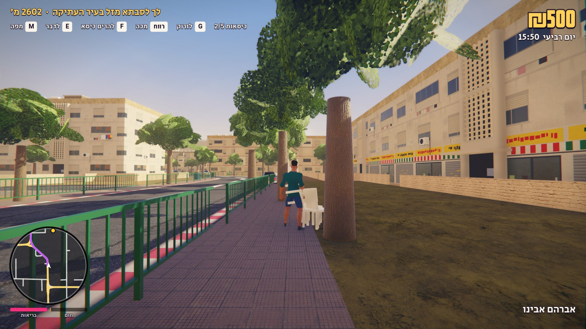
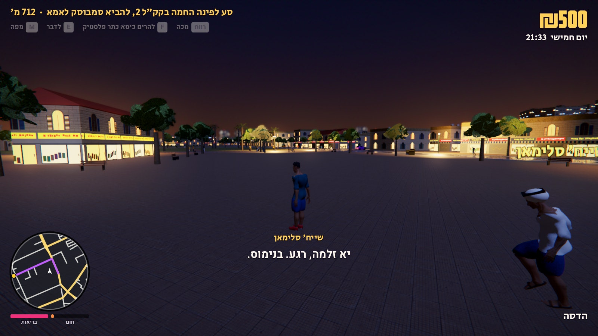
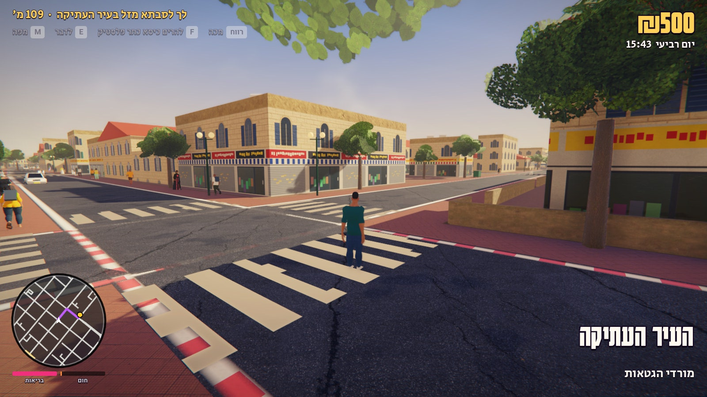

<p align="center"></p>

# BTA 7 Almosh City

**An open-source satirical open-world game set in the real streets of Beer Sheva, Israel.**
Built with [Godot 4.3](https://godotengine.org). Free to play, free to change, free to fork.

[עברית](README.he.md) · [Contribute](CONTRIBUTING.md) · [Credits](CREDITS.md) · [Licences](#licences)



> [!IMPORTANT]
> **This is satire.** It started as an inside joke among friends who grew up around Beer Sheva,
> and it laughs at everyone in town the same way: Bedouin traders, immigrants from the former
> USSR, veteran Mizrahi families, students, grandmothers, parking inspectors and the city council.
> Every gang and every character is invented. Nobody here is a portrait of a real person or of a
> real community, and nothing here is meant as a statement about one. If that is not your kind of
> humour, this is not your kind of game. Read more in [docs/SATIRE.md](docs/SATIRE.md).

## What it is

- The real street grid and building footprints of Beer Sheva, from the Old City to Ramot, built from
  OpenStreetMap, with landmarks such as the Pyramid House, the Negev Centre and the Turkish station.
- People come to you: a trader with a deal, a grandmother with a plate of food, an inspector with a
  fine. Say yes (**E**) or no (**Q**) and live with it. 118 of these encounters, all in plain JSON.
- Driving with traffic, handbrake turns, damage and fire. Street brawls with Keter plastic chairs.
  Rockets, camels and sandstorms. Day and night. A radio with five stations and a 78 rpm one.

| | | |
|---|---|---|
|  |  |  |

Most text in the game is in Hebrew.

## Play it

**From source (all platforms):**

1. Install [Godot 4.3](https://godotengine.org/download/archive/4.3-stable/) (the standard build, not .NET).
2. Clone this repository: `git clone https://github.com/dorongree-spec/bta7-almosh-city.git` (or download the ZIP from the green **Code** button)
3. Open Godot, choose **Import**, pick `project.godot`, then press **F5**.
   The first import takes a minute or two.

Or from a terminal: `godot --path .`

A GPU that handles Vulkan (Forward+ renderer) is needed. Development happens on Windows with an AMD
RX 6750 XT at about 57 fps; reports from other machines are welcome.

**Your own music:** put `.mp3` or `.ogg` files in a folder called `music` next to the game (or in the
project folder when running from Godot), and a station called "הדיסק של אבא" plays them.

### Controls

| Key | Action |
|---|---|
| WASD / arrows | walk or drive |
| Shift | run |
| Space / left click | punch; handbrake in a car |
| F | get in or out of a car, pick up a plastic chair |
| E / Q | yes / no when somebody asks you something; **E** next to a passer-by starts a chat |
| R | radio · **H** horn · **M** city map |
| Esc | pause (shows where you stand with each crowd) |

## Make it better

The game was built to be changed by people who don't write code. Most of it is data:

| You want to add... | Edit | Code? |
|---|---|---|
| a person who walks up with an offer, a joke or a fine | `data/encounters_*.json` | no |
| a radio station or a song | `data/world.json` + `assets/audio/radio/` | no |
| a joke, a billboard, a mom phone call, a radio ad | `data/world.json` | no |
| a named place on the map | `tools/guess_heights.py` (`KNOWN` list) | a line |
| a landmark building | `scripts/landmarks.gd` | yes, GDScript |

Step-by-step instructions, the content rules and how to send a pull request are in
**[CONTRIBUTING.md](CONTRIBUTING.md)**. Look for issues labelled
[`good first issue`](../../issues?q=is%3Aissue+is%3Aopen+label%3A%22good+first+issue%22).

Before you push, run `python3 tools/validate_content.py`. It checks every content file and tells
you in plain words what is wrong. CI runs it on every pull request.

## How the project is laid out

```
project.godot          Godot project (entry scene: scenes/main.tscn)
scripts/               one game system per file; each starts with a comment saying what it does
  main.gd              entry point: builds the world and wires the systems together
  encounters.gd        who walks up to you and what happens next
  encounter_bank.gd    loads and checks every data/encounters_*.json
  ui/                  loading screen, title, pause, captions, fonts and colours
data/                  content: people, jokes, radio, missions, and the map
assets/                models, textures, sounds, fonts, art (sources in assets/CREDITS.md)
tools/                 offline Python and Node tools: map import, city dressing, art, checks
docs/                  design notes, landmark research, run notes, screenshots
LICENSES/              full licence texts (see REUSE.toml for which file has which)
```

More detail: [docs/WORKFLOW.md](docs/WORKFLOW.md) (how the repo is worked on, screenshots, builds),
[docs/LANDMARKS.md](docs/LANDMARKS.md) (what is modelled and from which source).

### Rebuilding the map

`data/city.json` is generated from OpenStreetMap extracts:

    python3 tools/osm_to_city.py <tiles>.osm data/city.json --origin 31.24056,34.78802 --bbox 31.228,34.770,31.290,34.833
    python3 tools/guess_heights.py
    python3 tools/dress_city.py          # about 2.5 minutes; needs shapely and numpy

Download `.osm` tiles of the area from [openstreetmap.org](https://www.openstreetmap.org/export).

## Licences

This repository mixes code, writing, art and third-party assets, so it uses more than one licence.
Every file is covered; [`REUSE.toml`](REUSE.toml) says which applies to which, in the
[REUSE](https://reuse.software) format.

| What | Licence |
|---|---|
| Code: `scripts/`, `tools/`, `scenes/`, project files | [MIT](LICENSE) |
| Our own content: game texts and jokes in `data/*.json`, `assets/art/`, `docs/` | [CC BY-SA 4.0](LICENSES/CC-BY-SA-4.0.txt) |
| Map data `data/city.json`, `data/dressing.*`, derived from OpenStreetMap | [ODbL 1.0](LICENSES/ODbL-1.0.txt), © OpenStreetMap contributors |
| Third-party models, textures, sounds, music | CC0 / public domain, see [assets/CREDITS.md](assets/CREDITS.md) |
| Fonts (Heebo, Secular One, Karantina) | [SIL OFL 1.1](LICENSES/OFL-1.1.txt) |

In short: use the code for anything. If you reuse the jokes, characters or art, credit
"BTA 7 Almosh City contributors" and share your version under the same licence.

"BTA 7 Almosh City" is a parody title. This project has no connection to any commercial game,
publisher or brand, and uses no assets, logos or fonts from one.
